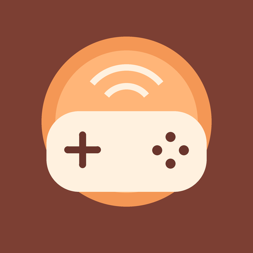
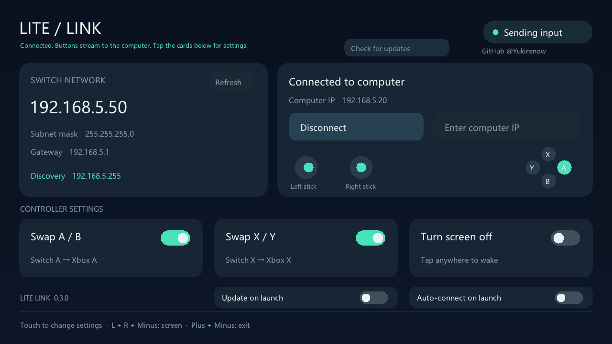

# Lite Link

**Turn a homebrew-enabled Nintendo Switch Lite into a wireless controller.**

English · [简体中文](README.zh-CN.md)

Maintained by [GitHub @Yukinsnow](https://github.com/Yukinsnow). Based on [Vins98/NXInput](https://github.com/Vins98/NXInput) and [WerWolv/SwitchXBOXController](https://github.com/WerWolv/SwitchXBOXController).

## Platform support

| Platform | Output | Status |
| --- | --- | --- |
| Switch / Switch Lite | Wi-Fi input sender | Tested on the user's Switch Lite; v0.2 localization/icon updates need device verification |
| Windows | Virtual Xbox 360 controller through ViGEmBus | Working; adapter selection, reconnect and UDP tests pass |
| macOS 15+ | Native CoreHID virtual gamepad | **Experimental; requires an Apple-approved virtual HID entitlement and matching signing profile. Not a ready-to-use controller on an ordinary unsigned build.** |

The macOS backend creates a real generic HID gamepad, never keyboard/mouse events. Apple restricts `com.apple.developer.hid.virtual.device`; a normal Apple Developer signature, Accessibility permission, or running as root does not replace an approved provisioning profile. Without authorization, the app refuses to start the controller session and shows an error. Generic HID support varies by game; GameController-only titles are not guaranteed. See [macOS build and signing](docs/macOS.md).

## Features

- Touch-friendly Switch UI, live buttons and stick indicators.
- Automatic Chinese/English UI from each device's system language: Chinese locales use Chinese; all others use English.
- LAN discovery based on the actual Switch IP and subnet mask, plus manual IP entry.
- Explicit Windows/macOS adapter selection for multi-NIC computers.
- Independent A/B and X/Y swaps, saved on the Switch SD card.
- Screen backlight off while input continues; tap anywhere to wake.
- Input release after 500 ms without valid packets, and same-device reconnect.
- Original icon options; **C — Sunrise Pad** is the selected default.

## Windows quick start

Download the packages from [Releases](https://github.com/yukinsnow/Lite-Link/releases). Windows and Switch packages are separate; the macOS archive is explicitly experimental.

1. Install [ViGEmBus](https://github.com/nefarius/ViGEmBus/releases/tag/v1.22.0) if it is not already installed. It is an archived dependency; .NET Framework 4.8 is also required.
2. Extract the Windows receiver and keep its `.exe`, `.dll` and `.config` files together.
3. Run `NXInput Server.exe`, select the IPv4 adapter reachable from the Switch, then start the server.
4. Copy `SwitchLiteController.nro` into `/switch/SwitchLiteController/` on the SD card, then launch it from hbmenu.
5. Tap **Find computer**, or enter the computer IP shown by the receiver. Allow the receiver on your private network if Windows asks.
6. Run `joy.cpl` on Windows to test the virtual Xbox 360 controller before opening a game.

The Switch and computer need a reachable local network. UDP **8193** is discovery, **8192** is handshake/input. Broadcast discovery normally stays within one subnet; use manual IP for routed networks. Selecting an adapter does not change your system gateway or routes. The input protocol is designed for a trusted LAN and has no authentication or encryption; do not port-forward it.

## Switch controls

| State | Controls |
| --- | --- |
| Before connecting | Touch buttons, or D-pad to select / A to confirm; X finds a computer; Y refreshes; Plus exits |
| While connecting | B cancels |
| Connected | Buttons go to the game; touch the settings cards |
| Screen off / wake | Hold L + R, then press Minus; or tap anywhere to wake |
| Exit | Plus + Minus |

Screen-off only changes the backlight; the power button still suspends the system. Normal disconnect, exit, or loss of foreground focus attempts to restore the backlight. Settings are saved to `/switch/SwitchLiteController/settings.ini`; screen-off state is never saved. Force-terminating an app can prevent cleanup.

| Setting | Off: original physical layout | On: match button letters |
| --- | --- | --- |
| Swap A/B | Switch A → Xbox B; B → A | A → A; B → B |
| Swap X/Y | Switch X → Xbox Y; Y → X | X → X; Y → Y |

ZL/ZR are digital triggers. Gyro, touch-as-game-input and rumble are not implemented. The on-screen indicators show local input, not acknowledgment from the computer.

## Startup and remembered settings

- **Windows:** remembers the selected adapter ID/IPv4 and last Switch IP in `%APPDATA%/LiteLink/settings.xml`. Enable **Launch Lite Link when I sign in to Windows** for current-user login startup (no administrator required). Enable **Start receiving when the app opens** to start the server using the remembered adapter. These are separate options and default off. If DHCP changes its address, the same adapter is restored only when its IPv4 choice is unambiguous; an unavailable saved adapter is never replaced by a different adapter automatically. Startup waits up to 60 seconds for it to appear.
- **Switch:** remembers the last successful computer IP, button swaps, auto-connect and auto-update in `/switch/SwitchLiteController/settings.ini`. **Auto-connect on launch** tries the remembered computer first, then LAN discovery if it times out. Touch or press a button during the two-second startup delay to cancel. This means automatic connection when **Lite Link opens**, not launching homebrew when the Switch powers on.
- Settings are saved with a temporary file and a backup/atomic replacement. Existing older Switch settings remain compatible. Failed writes keep the current session's settings and show an error.

## GitHub Release updates

Install **v0.3.0 manually once** to get the updater. Thereafter Windows and Switch check the latest non-draft, non-prerelease GitHub Release from this repository. Automatic installation is **off by default**.

- **Windows:** use **Check updates** to check manually and confirm installation, or enable **Install stable updates on launch**. Checking is allowed while receiving, but installation requires the receiver to be stopped. Downloads use HTTPS/TLS 1.2 and the release's `SHA256SUMS.txt`; only the exact three receiver payload files are extracted. A local helper waits for this app to exit, backs up/replaces files in the same folder and restarts it. Copy/launch failures attempt rollback; preferences and login startup remain in place. Keep the executable at its registered location.
- **Switch:** tap **Check for updates**, then **Install update** to confirm; or enable **Update on launch**. Disconnect first. The app downloads the raw versioned `.nro` over verified HTTPS, checks SHA-256 and NRO headers, stages it on the SD card, keeps the previous `.nro.bak`, and exits to the menu. Reopen Lite Link to run the new version. B cancels network transfers before installation. Unknown executable paths or write failures refuse installation. Screen-off state is not restored after updates.
- Releases must include `Lite-Link-vX.Y.Z-Windows.zip` (with the three files under `Windows/`), `Lite-Link-vX.Y.Z-Switch.nro`, and matching `SHA256SUMS.txt` entries. Checksums protect integrity; the GitHub repository/release publisher remains the trust source. There is no signing-key authentication beyond verified HTTPS.
- macOS stays experimental and does **not** yet have these startup/update controls. It still requires Apple's restricted virtual HID authorization.

Updater tests cover metadata/version parsing, corrupted checksums, exact-path extraction, settings persistence, legacy settings and backup recovery; Windows also passed a real GitHub release check. Actual in-place restart and Switch HTTPS/NRO replacement still need device verification. Startup and automatic-update options are never enabled by the build or installer.

## Build

- **Switch:** install devkitPro `switch-dev`, `switch-curl` and `switch-zlib`, then `cd Switch_Client && make`. On Windows, `Build-Switch.ps1 -DevkitPro <toolchain-root>` also works.
- **Windows:** Visual Studio with .NET desktop development and .NET Framework 4.8 targeting pack; build `Windows_Server/NXInput Server.sln` in Release.
- **macOS:** Xcode / Swift 6 and macOS 15 SDK; `bash macOS/build-app.sh`. The default app is an ad-hoc-signed diagnostic build without the restricted entitlement. See [signing requirements](docs/macOS.md).

GitHub Actions builds all three platforms. Tests cover UDP discovery/reconnect/timeouts, multi-adapter binding, button permutations, portable UI rendering, and the macOS HID report encoder. A green build alone does not prove Apple authorization or physical-device compatibility.

## Icons and screenshots

All four original designs include SVG, PNG, JPG and multi-size ICO files in [`assets/icons`](assets/icons). Default: **C — Sunrise Pad**. Font rendering may differ between desktop previews and the Switch system font.

## Credits and license

Lite Link is a modified GPL-3.0 project. Preserve the original [LICENSE](LICENSE) and upstream authors when redistributing. Core Switch/Windows transport and controller mapping originate from NXInput / SwitchXBOXController; the UI, locale switching, screen controls, branding, additional tests and experimental macOS receiver are local additions. `stb_truetype` uses its separately included [license](Switch_Client/source/vendor/LICENSE-stb.txt). Icons are original project assets released under the project license. No Nintendo fonts, Apple signing profiles, or proprietary SDK files are distributed.

Not affiliated with Nintendo, Microsoft or Apple.
