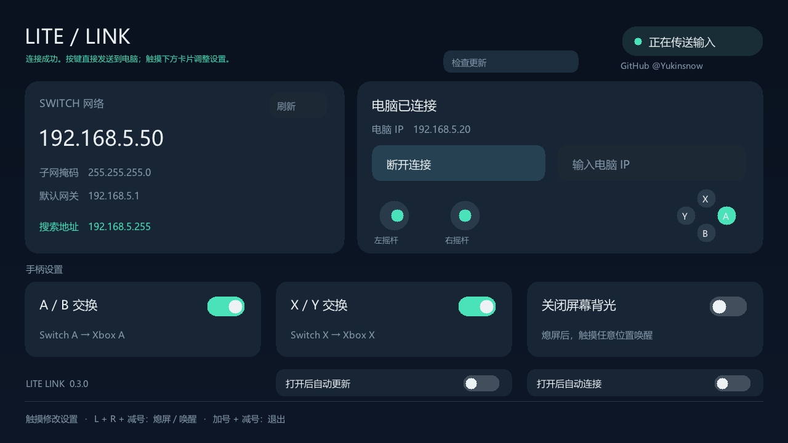
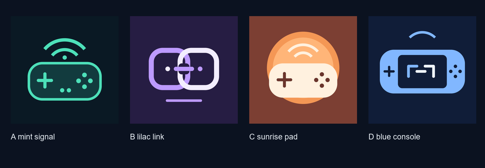

# Lite Link

**把能运行自制软件的 Nintendo Switch Lite 变成无线手柄。**

[English](README.md) · 简体中文

维护者：[GitHub @Yukinsnow](https://github.com/Yukinsnow)。基于 [Vins98/NXInput](https://github.com/Vins98/NXInput) 和 [WerWolv/SwitchXBOXController](https://github.com/WerWolv/SwitchXBOXController)。

## 平台状态

| 平台 | 输出 | 状态 |
| --- | --- | --- |
| Switch / Switch Lite | Wi-Fi 输入发送端 | 用户已验证旧版功能；0.2 的语言和图标更新仍需实机确认 |
| Windows | ViGEmBus 虚拟 Xbox 360 手柄 | 可用，多网卡、重连和 UDP 测试通过 |
| macOS 15+ | CoreHID 真正的虚拟 HID 手柄 | **实验性。需要 Apple 批准的专用虚拟 HID 权限和匹配的签名描述文件；普通未授权构建不能当作开箱即用手柄。** |

macOS 不会使用键盘/鼠标映射替代手柄。Apple 限制 `com.apple.developer.hid.virtual.device`，辅助功能授权、root 或普通开发者签名都不能替代经过批准的配置描述文件。创建失败时会明确报错，且不会假装建立了可用的手柄会话。通用 HID 的游戏兼容性仍需验证。详见 [macOS 构建和签名](docs/macOS.md)。

## 功能

- Switch 触摸图形界面、实时按钮和摇杆指示。
- 按设备自身系统语言自动选择中英文；中文系统显示中文，其他语言显示英文。
- 根据真实 IP 和掩码生成搜索地址，支持手动电脑 IP。
- 电脑端明确选择网卡，适用于多网卡、VPN、热点场景。
- A/B、X/Y 两组独立交换，保存至 SD 卡。
- 连接时关闭背光，继续发送输入；触摸唤醒。
- 500 毫秒无有效输入后归零，同一设备换端口重连。
- 默认图标采用 **C 日落手柄**，另附三款原创备选。

## Windows 快速使用

从 [Releases](https://github.com/yukinsnow/Lite-Link/releases) 下载；Windows、Switch 分开打包，macOS 包明确标为实验性。

1. 安装 [ViGEmBus](https://github.com/nefarius/ViGEmBus/releases/tag/v1.22.0) 和 .NET Framework 4.8；已能正常测试的电脑无需重装。ViGEmBus 已归档。
2. 保持 Windows 接收端的 `.exe`、`.dll`、`.config` 文件在同一文件夹。
3. 运行 `NXInput Server.exe`，选择与 Switch 通信的 IPv4 网卡，启动服务。
4. 将 `.nro` 放至 SD 卡 `/switch/SwitchLiteController/`，通过 hbmenu 启动。
5. 在 Switch 自动搜索，或填写接收端显示的电脑 IP。防火墙提示时允许专用网络访问。
6. 电脑运行 `joy.cpl` 测试虚拟 Xbox 360 手柄，再进入游戏。

UDP 8193 用于自动发现，8192 用于握手和输入。广播通常不能跨子网；可路由的跨网段请手动填写 IP。选择网卡不会修改系统网关或路由。此协议用于可信局域网，没有认证或加密，不要映射到公网。

## Switch 操作

| 状态 | 操作 |
| --- | --- |
| 未连接 | 触摸，或方向键选择、A 确认；X 搜索、Y 刷新、加号退出 |
| 正在连接 | B 取消 |
| 已连接 | 物理按钮用于游戏；触摸卡片修改设置 |
| 熄屏/唤醒 | 按住 L+R，再按减号；也可触摸屏幕任意位置唤醒 |
| 退出 | 同时按加号和减号 |

熄屏只关闭背光，电源键仍会让系统休眠。正常断开、退出、失去前台焦点时会尝试恢复背光；强制杀死程序可能无法执行清理。配置保存在 `/switch/SwitchLiteController/settings.ini`；不保存熄屏状态。

| 设置 | 关闭：原版物理位置对应 | 开启：按字母对应 |
| --- | --- | --- |
| A/B 交换 | Switch A→Xbox B，B→A | A→A，B→B |
| X/Y 交换 | Switch X→Xbox Y，Y→X | X→X，Y→Y |

ZL/ZR 是数字扳机。不支持陀螺仪、触屏游戏输入和震动回传；界面指示是本机输入，不是电脑接收回执。

## 自启动和记忆设置

- **Windows：**在 `%APPDATA%/LiteLink/settings.xml` 保存网卡 ID、IPv4、上次 Switch IP。勾选“登录 Windows 后自动启动”设置当前用户登录自启动，不需要管理员；另勾选“打开应用后自动接收”才会使用记忆网卡启动接收。两个开关默认关闭。DHCP 改变 IP 时仅在同一网卡地址唯一时恢复；不会自动切到其他网卡。登录时最多等待记忆网卡上线 60 秒。
- **Lite：**保留上次成功连接的电脑 IP、按键交换、自动连接和自动更新。勾选“打开后自动连接”，下次打开先连接上次电脑，超时后搜索当前局域网。打开后有两秒延迟，可触摸或按键取消。这里是 **Lite Link 打开后自动连接**，不是 Switch 开机自动运行自制程序。
- 保存时先写临时文件，再备份/替换，兼容旧版设置。SD 卡保存失败会保留本次运行的设置并提示。

## 根据 GitHub Release 更新

**先手动安装一次 v0.3.0**，之后可在程序里更新。只检查本仓库正式、非草稿、非预发布的最新 Release，自动安装默认关闭。

- **Windows：**点击“检查更新”，确认后下载、校验并重启；或启用“打开时自动检查并安装正式版更新”。接收时可以检查版本，但安装前必须停止接收，避免中断游戏。使用 HTTPS/TLS 1.2，按 `SHA256SUMS.txt` 校验，只提取明确允许的三个接收端文件。助手等待旧程序退出后原位备份/替换，并重启；复制或启动失败时尝试回滚。配置和登录自启动不会被覆盖。请保留已注册的程序位置。
- **Lite：**点击“检查更新”，发现新版后再次点击“安装更新”确认；也可勾选“打开后自动更新”。先断开连接，使用验证证书的 HTTPS 下载独立 NRO、校验 SHA-256 和 NRO 结构后替换，保留 `.nro.bak`，返回菜单后重新打开。下载时可按 B 取消。无法确认当前 NRO 路径或 SD 写入失败时拒绝安装，不保存熄屏状态。
- Release 需包含对应版本的 Windows ZIP、独立 Switch `.nro` 和 `SHA256SUMS.txt`。校验值用于完整性检查，仍信任本 GitHub 仓库的发布者，不是独立签名认证。
- macOS 仍是实验版，暂不增加上述自启动/更新控制，且真正虚拟 HID 输出仍需 Apple 专用授权。

测试覆盖版本/元数据解析、错误校验值、路径限制提取、配置保存、旧设置和备份恢复；Windows 已实际访问 GitHub 检查版本。真实应用原位重启、Switch HTTPS/NRO 替换仍需实机验证。构建和安装包不会替你启用自启动或自动更新。

## 构建和测试

- Switch：devkitPro `switch-dev`、`switch-curl`、`switch-zlib`；`cd Switch_Client && make`，或 Windows 下运行 `Build-Switch.ps1 -DevkitPro <工具链根目录>`。
- Windows：Visual Studio 的 .NET 桌面开发和 .NET Framework 4.8 开发工具，Release 构建 `Windows_Server/NXInput Server.sln`。
- macOS：Xcode / Swift 6、macOS 15 SDK；`bash macOS/build-app.sh`。默认构建是没有受限权限的临时签名诊断包；详见签名文档。

GitHub Actions 构建三端，测试包括 UDP、多网卡、重连、超时、按键交换、界面绘制和 macOS HID 报告编码。编译成功不等于已获得 Apple 授权，也不替代实机测试。

## 图标

默认 C 日落手柄。四款 SVG、PNG、JPG、ICO 文件均位于 [`assets/icons`](assets/icons)。电脑预览和 Switch 系统字体可能略有区别。

## 许可和致谢

沿用 GPL-3.0 [LICENSE](LICENSE) 和上游作者归属。Switch/Windows 的核心传输和映射来自 NXInput / SwitchXBOXController；新增界面、多语言、背光、署名、测试和实验性 macOS 后端为本地修改。stb_truetype 使用单独附带的第三方许可。原创图标随项目许可发布。不分发 Nintendo 字体、Apple 签名文件或专有 SDK。

本项目与 Nintendo、Microsoft、Apple 无隶属关系。
